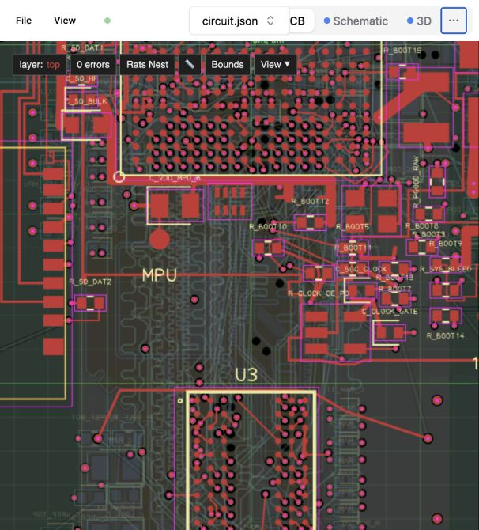

# AM3352 DDR3 and RGB888 HDMI

The logical design is native TSX in [`index.tsx`](index.tsx): 347 components, 23 schematic sheets, the current DDR DQ permutation, RGB888 HDMI, U16 SD card detect, and V17/GPIO1_27 HDMI IRQ with V14 released. Source parity passes for all 1,472 physical pin identities and net bindings against the selected `d5e8f9ac…230c98b` layout. All 324 CPU balls and 96 RAM balls have native schematic representations. [Parity evidence](validation-source/source-parity-v5.json).

**55 video-bus joins remain open. This board is not fabrication-ready.**

The physical layout remains routing work in progress. HDMI routing and merged clearance, return-path and DDR/HDMI signal-integrity validation are unfinished; no functional DDR or HDMI margin is established.

## Develop and build

Requires Bun and Python 3.9 or later.

The default PCB preview contains the checked saved paths; `index.tsx` supplies the native logical design and schematic.



```sh
bun install --frozen-lockfile
bun run dev
# Optional: PORT=3030 bun run dev
```

Dev first renders the real TSX and replays its compatible saved layout, then serves an isolated mirror containing only the static source import graph and one generated artifact. It follows TSX edits and recompiles the replay; incompatible changes reject the update and retain the last successful preview. This avoids uploading the large validation/simulation directories.

- **Authoring:** select `index.tsx` for Code and Schematic.
- **Paths and placement:** select `index-with-layout.circuit.json` → PCB. This generated view also includes the fresh native schematic.

The default preview/site uses the generated replay. Opening the direct `index.tsx` PCB tab shows native source geometry without saved paths: the source declares no manual `pcbPath` routing or faithful physical-state replay. `routingDisabled` stops automatic routing; it does not suppress supported manual `pcbPath` traces. The generated preview is the path-bearing workaround.

```sh
bun run replay:layout  # fresh native render + protected layout replay
bun run build          # same guards, then an isolated native/site build
```

A successful build replaces generated `dist/`. Neither command reconstructs the old published baseline or overwrites routed source files.

## Source and physical state

The replay compiler combines native TSX logic/schematic records with exact saved PCB/CAD records. It preserves traces, full-layer via barrels, pours, component placement and mechanical geometry verbatim. It verifies source/pin/net/value identities and a bound native footprint/placement fingerprint, and rejects incompatible edits rather than silently stretching or removing routing. Schematic-only edits can replay normally.

`validation-source/layout-binding-v5.json` identifies the selected physical snapshot and compatibility fingerprint. It includes the selected V17 IRQ, U16 SD card detect, Top `R_BOOT15`, four-pair TMDS routing, and reviewed HDMI power/utility routing with four widened power traces. Native source includes the accepted Bottom `C_HDMI_REF_C178` and Top `R_HDMI_UTILITY` placements. New physical routing or placement must be reviewed and bound explicitly as a new state. This publication contains the selected v5 snapshot; older working snapshots remain outside this repository.

The v5 compiled snapshot is [`index-with-layout-v5.circuit.json`](validation-source/index-with-layout.circuit.json), with exact saved PCB/CAD records and the verified native schematic. Source and placement are unchanged from v4; the width-only update leaves 55 video-bus joins open. Its receipt discloses 10 existing named-net trace aliases and 13 exact placement comparisons overridden by the saved layout: 12 DebugStatus poses plus one negligible floating-point difference. Strict native-versus-saved placement parity and DDR/HDMI signal-integrity margins remain unproven.

[`validation-source/LAYOUT-REPLAY.txt`](validation-source/LAYOUT-REPLAY.txt) documents the workflow. The replay receipt records input/output hashes and ID mappings; seven native array models are retained separately. Bug reproductions use real TSX, including the [replay fixture](validation-source/layout-replay-fixture.circuit.tsx).

Original source: [tscircuit project](https://tscircuit.com/0hmX/am3352-ddr-track-a-local-dfm-wip-20261007). This repository publishes the selected board source and layout, rather than the scratch routing history or downloaded vendor assets. See [third-party notices](THIRD_PARTY_NOTICES.md).

## Simulation status

No accepted board DDR field solution, eye, or hardware boot result exists. The files in `simulations-next/` preserve experimental native TSX declarations; they are not a turnkey simulation command in this snapshot. Native solver integration, vendor-model preparation and validation remain separate work. No vendor IBIS bytes, solver binaries, synthetic completed results or custom simulation HTML are included.

Historical receipts preserve their original source paths and hashes. [Publication manifest](publication-manifest.json) records the files shipped here and the exact native-source/layout hashes.
