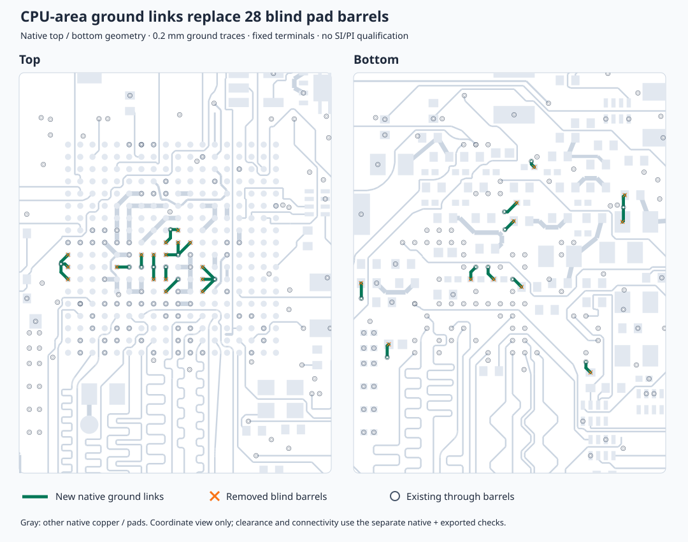

# CPU-area surface ground links replace 28 blind pad vias

Reroutes 28 ground terminals to nearby existing through barrels with literal
native TSX traces, then removes their blind pad vias from `CloudPowerRoutes.tsx`.
Source-array null slots preserve all later via names. Links are 0.2 mm wide,
0.461348–1.190538 mm long, with straight/45-degree turns. The selected lands sit
inside their GND SMT pads; no trace/pour selectors reference the removed names.
Targets remain fixed. No JSON data changes or route-data imports.

[Complete inventory and verification](cpu-ground-surface-validation.json):
**636 through / 540 non-through**, 1,176 total vias (533 snapshot conversion
shorts + seven clearance-only; one pour-only / 539 involving other copper).
Native render succeeds and all 686 connectivity entries remain connected.
No shorts, lost nets, new enforced clearance findings, additional optional
plated-hole margins or additional reference gaps. All original component
pin-net assignments and placements are unchanged, including processor and DDR.
All original trace centerlines are preserved; only the 28 ground traces add
44 nonzero segments. All retained via positions, nets, diameters and spans
are unchanged. Existing placement findings and 86 sampled sharp-turn traces
remain; official style analysis remains unavailable.

Independent exported Gerber/Excellon parsing passes for 257/257 named groups,
zero shorts/missing copper/drills, and 1,202 matched barrel records. Actual
post-drill GND retains all 416 component terminals in one group through 499
matched ground barrels. This verifies DC continuity and geometric clearance;
local current-return distribution, SI/PI and current capacity are unqualified.
Mixed drill spans and `allowBlindAndBuriedVias` remain.
