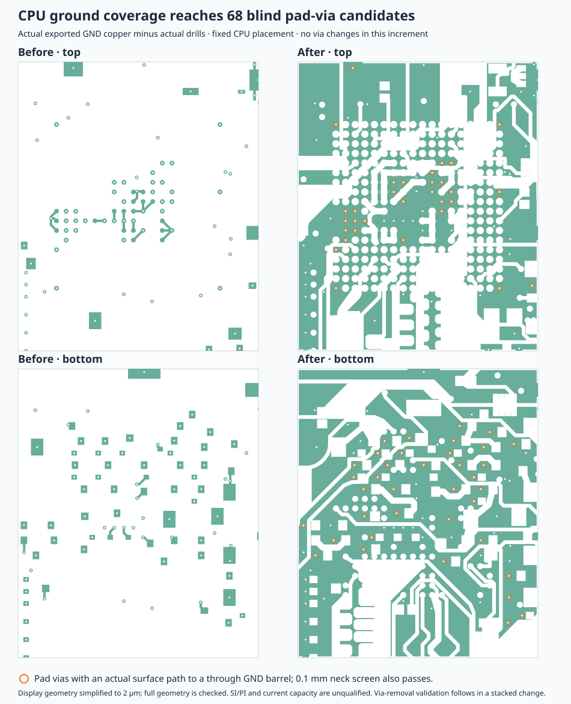

# CPU surface ground coverage before pad-via removal

Adds local native TSX GND pours on top and bottom over x[-10,10], y[-12,12] mm.
A 0.105 mm source offset reserves polygon-approximation margin for the board's
0.1 mm copper rule. The measured minimum emitted other-net copper gap is
**0.103449 mm**; all 50 emitted surface-pour pieces pass the new clearance check.
The nominal 0.1 mm candidate was rejected: minimum 0.098555 mm, 1,097 findings.
Actual TSX tests reproduce that offset error and verify the source margin.



The new read-only coverage check finds **68 CPU-area blind pad-via removal
candidates**, versus zero before these fills. Each land is inside its GND SMT
pad, has no trace/pour selector references, and shares actual post-drill surface
copper with a matched through GND barrel. The path also survives erosion by
half the board's 0.1 mm minimum trace width before subtracting actual drills;
no dilation rejoins disconnected pieces. Fourteen pad vias remain outside
this criterion. These are candidates; removal requires the next stacked build.

[Complete inventory and verification](cpu-surface-ground-margin-validation.json):
**636 through / 526 non-through**, 1,162 total (519 snapshot conversion shorts +
seven clearance-only). No via or trace geometry changes. All 8,177 original
centerline segments, pin nets and placements are preserved. Native render and
686/686 connectivity entries pass, with zero shorts/lost nets/new enforced
clearances, optional drill-margin additions or reference-gap additions.
Independent Gerber/Excellon checks retain 257/257 named groups, all 1,188 barrel
records and all 416 GND terminals in one actual post-drill group. Eight tests /
41 assertions pass. Existing spacing/placement/style findings remain inherited.

To reproduce after exporting Gerbers and preparing a native analysis directory:

```sh
python3 scripts/cloud-postdrill-ground.py work/native work/ground.json
python3 scripts/check-surface-ground-necks.py work/ground.json work/ground-neck.json work/native
bun scripts/check-surface-ground-pad-vias.tsx work/native/board.circuit.json work/ground-neck.json work/coverage.json
bun scripts/check-surface-pour-clearance.tsx work/native/board.circuit.json work/clearance.json
```

The neck check verifies its cached geometry against the native build, checker
and exported file hashes. The visual simplifies display geometry to 2 µm; checks
use full geometry. SI/PI and current capacity are unqualified. Mixed spans and
`allowBlindAndBuriedVias` remain. No JSON routing source changes or new route data.
