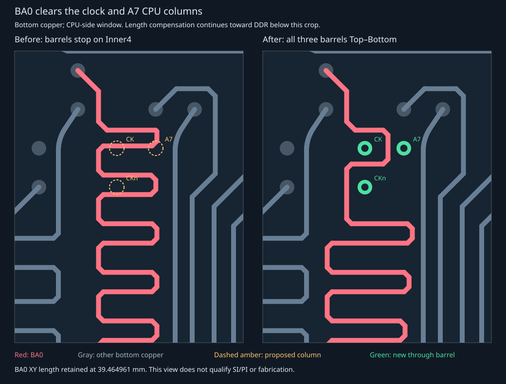

# Clock/A7 CPU barrel relief

Ports the affected BA0 path from the mounted JSON-backed composition into a literal
native TSX trace in `StandardDdrThroughVias.tsx`. No route-data JSON changes or
additions. Reshapes BA0's under-BGA meanders to clear the CK, CKn and A7 CPU columns.
Five meander caps farther toward DDR compensate the removed length. All corners
in the adjusted region remain horizontal/vertical/45-degree segments.

The original **39.464961 mm XY length** is retained to floating-point precision;
native `trace_length` metadata stays 42.664961 mm. That metadata is not an electrical
delay qualification. CK/CKn/A7 wires, every other signal's nonzero wire segments,
all component placements, all 1,527 original component-pin net assignments and
all via positions/nets/diameters are unchanged.

Three existing CPU pad-centered barrels become explicit Top..Bottom vias:

| Native source via | CPU pin | Retained signal layer |
| --- | --- | --- |
| STD_DDR_CK_CPU | U1.D2 | Inner4 |
| STD_DDR_CKn_CPU | U1.D1 | Inner4 |
| STD_DDR_A7_CPU | U1.E2 | Inner4 |

[Validation](ddr-clock-relief-validation.json): **356 through / 854 non-through**
(843 snapshot shorts + 11 clearance-only; 258 pour-only / 596 involving other copper).
Native render errors 0; 686/686 connectivity entries connected; zero shorts or new
findings. Inherited 20 different-net + 3 same-net via-spacing findings remain.
Independent emitted Gerber/Excellon verification passes: 257/257 named-net groups
connected, no shorts/missing copper/missing drills, 1,236 barrel records matched.
Four native TSX tests / 23 assertions pass. Multiple drill spans remain.

The bounded local screen tested 441 right-rail/return-row combinations against
0.1 mm clearance to current bottom copper and the three new columns; 81 passed.
A subset with extra clearance was used, then five compensated caps were screened
before the native render. Reserving *every* future through column found no valid
adjustment in this local family, because A7 and a nearby buried ground return
also constrain the space. This staged change converts A7 too; it does not establish
unroutability of that ground return or the rest of DDR. No fixed parts moved or
layers added. SI/PI, reference-area coverage and fabrication remain unqualified.
