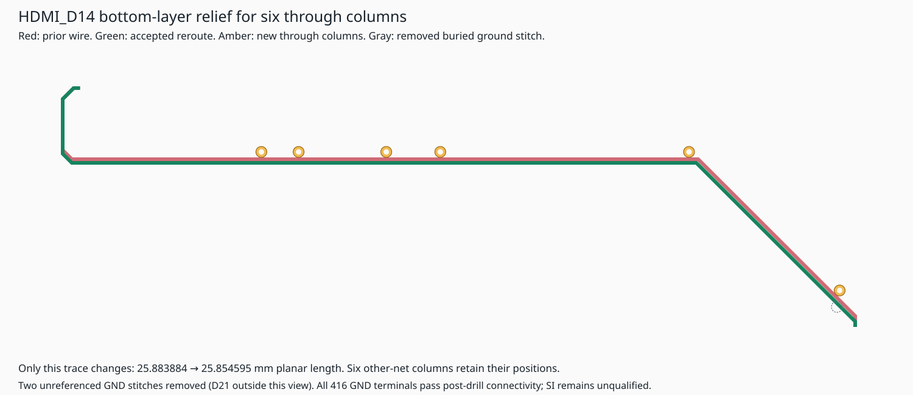

# HDMI D14 relief and six through columns

Replaces the mounted D14 resistor-array escape with literal native TSX, shifting
its diagonal by 0.15 mm and long bottom segment by 0.1 mm. Converts five standalone
via definitions and the PMIC_PB_N pad endpoint into six explicit native through
barrels. The affected endpoint route is ported from its mounted JSON-backed
path into TSX; new modules import no route data and original JSON is unchanged.

Removes two unreferenced, non-pad GND stitches at their TSX sources:
`D21_CPU_I1_I3_RETURN` and `RN5_EAST_RETURN_1`. Neither is a trace/pour endpoint.
The D21 through extension had cut V3V3; the RN5 stitch obstructed the new D14
column corridor. Their DC redundancy is checked below. Local return inductance
and SI after removal are not qualified. A bounded 0.05 mm / 0.8 mm nudge screen
found no all-layer placement for RN5; it does not establish global unroutability.

[Complete inventory and validation](hdmi-d14-relief-validation.json): **626
through / 582 non-through** (573 snapshot shorts + nine clearance-only;
two pour-only / 580 involving other copper). All 686 native connectivity entries
remain connected, with no render errors, shorts, lost nets or new enforced
clearance findings. Six new optional plated-hole margin findings are retained.
All 1,527 original component-pin net assignments and all placements are unchanged;
all retained vias keep positions/nets/diameters. Only D14's nonzero wire geometry
changes, from 25.883884 to 25.854595 mm planar length. No timing claim follows.

Independent exported Gerber/Excellon parsing passes for 257/257 named groups,
zero shorts/missing copper/drills, and 1,234 barrel records matched. Actual
post-drill GND connects all 416 component terminals in one group through 531
matched GND barrel records. Six TSX tests / 35 assertions pass. Native placement
findings remain inherited: five outside-board, 15 missing courtyards, three
courtyard overlaps, one connector orientation; basic overlap/keepout checks are
zero. Sampled trace-style counts remain 86 sharp-turn traces; changed D14 has
only straight/45-degree geometry. The official style analyzer remains unavailable.

Spatial reference comparison records two additional uncovered-area pairs on two
traces (0.203787600 mm²); three Inner6 routes remain unassessed. Mixed drill spans
remain, and `allowBlindAndBuriedVias` stays enabled. This is routing/continuity
evidence, not SI/PI/current-capacity or fabrication qualification.
