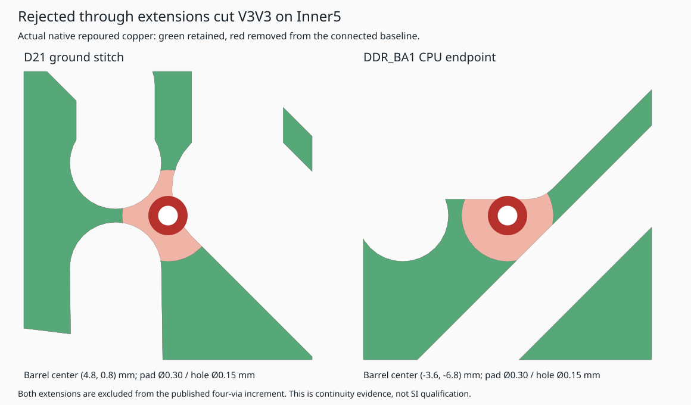

# Four strap/reference through vias; rejected supply cuts

Ports four affected mounted via definitions into literal native TSX: RN0's GND
reference and three SYSBOOT1/5 resistor-array/pull terminals. New module imports
no route data; original JSON is unchanged. Matched inner ports preserve native
trace-layer references.

[Complete inventory and validation](remaining-four-validation.json): **620
through / 590 non-through** (581 snapshot shorts + nine clearance-only;
two pour-only / 588 involving other copper). All 686 native connectivity entries
remain connected, with zero render errors, shorts, lost nets or new enforced or
supplemental clearance findings. All trace copper, 8,107 complete nonzero
centerlines, original pin-net assignments, component placements and via
positions/nets/diameters remain unchanged. Inherited spacing findings remain.

The initial six-extension candidate was rejected: D21's GND barrel on Inner5
cuts off ten V3V3 terminals; DDR_BA1's CPU barrel separately isolates R_BOOT14's
supply pad. Its V3V3 groups contain 10/90/1 terminals. A variant removing only D21
restores the ten-terminal bank but leaves R_BOOT14 isolated (100/1). Native
verification exits 1 on both variants. These are concrete continuity failures,
despite no shorts or new clearance findings. Both excluded vias are restored to
their original spans/positions in this increment. No stitch is removed.

Independent Gerber/Excellon parsing passes for 257/257 named groups, with zero
shorts/missing copper/drills and 1,236 barrel records matched. Actual post-drill
GND connects all 416 terminals in one group. Spatial reference analysis records
three additional uncovered-area pairs across two traces (0.018349973 mm²); three
Inner6 routes remain unassessed. Mixed drill spans remain, and
`allowBlindAndBuriedVias` stays enabled. SI/PI/current capacity and fabrication
release remain unqualified.
